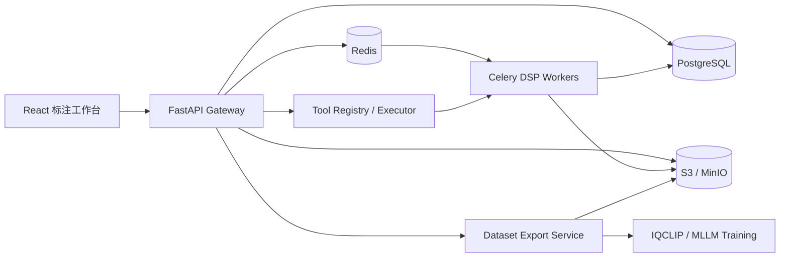
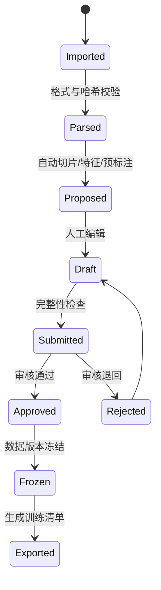

# IQ 多模态数据标注平台技术解决方案

## 1. 建设目标

本平台用于生产可追溯、可审核、可复现的 IQ 多模态训练数据，支持两条数据生产线：

1. **IQ-文本配对数据**：训练 IQ Encoder 与文本表征的对比学习模型（IQCLIP），使编码器获得检索、分类和迁移能力。
2. **IQ 指令与智能体数据**：训练 `IQ Encoder + Projector + LLM`，覆盖问答、分析、测量、诊断以及工具调用。

平台不把一个 IQ 文件直接等同于一条训练样本。统一的数据层次为：

```text
Project -> DatasetVersion -> SignalAsset -> Capture -> Segment
                                                |-> IQTextPair
                                                |-> InstructionRecord
                                                |-> AnnotationValue
```

其中 `Segment` 是标注、审核和训练导出的最小证据单元；同一 Segment 可关联多条文本配对和多条指令轨迹。

## 2. 核心设计原则

- **原始数据不可变**：IQ 文件进入对象存储后以 SHA-256 标识，任何预处理结果均作为派生资产保存。
- **采样点索引优先**：区间使用 `sample_start` 和 `sample_count` 表达，时间仅作为计算展示值，避免浮点误差。
- **事实与推断分离**：采集真值、算法计算、人工判断、模型建议和合成真值必须记录不同 `source`。
- **证据绑定**：语义标签、Caption 和回答应绑定 IQ Segment 或时频框选区域。
- **任务相关增强**：每种增强声明其保持和改变的语义；例如循环时移可用于调制识别，但未必适合时序定位任务。
- **版本化生产**：标签体系、算法、工具 Schema、预处理配置、数据切分和导出清单全部版本化。
- **防止数据泄漏**：训练、验证、测试集按采集会话、发射机或设备分组，不按随机窗口切分。

## 3. 总体架构



### 3.1 技术选型

| 层级 | 推荐技术 | 职责 |
|---|---|---|
| Web | 现有 React 19、TypeScript、Vite | 标注、审核、数据管理和任务编辑 |
| API | Python FastAPI、Pydantic | 资源 API、Schema 校验、权限与工作流 |
| 元数据 | PostgreSQL | 项目、片段、标注、审核、版本和审计记录 |
| 对象存储 | MinIO（本地）/ S3（生产） | 原始 IQ、派生特征、缩略图和导出包 |
| 异步计算 | Celery + Redis | 解析、切片、特征计算、预标注和导出 |
| DSP | NumPy、SciPy、PyTorch、SigMF | IQ 读取、STFT、特征提取和模型推理 |
| 数据交付 | JSONL、Parquet/Arrow、SigMF | IQCLIP、HuggingFace 和 LLM 训练适配 |

单机开发环境可使用 Docker Compose 部署 PostgreSQL、MinIO、Redis、API 和 Worker。生产环境再按任务吞吐量水平扩展 Worker。

## 4. 数据模型

### 4.1 信号资产与采集记录

`SignalAsset` 保存物理文件信息：

```json
{
  "id": "asset_01",
  "object_uri": "s3://iq/raw/sha256.sigmf-data",
  "sha256": "...",
  "byte_size": 8388608,
  "format": "sigmf",
  "datatype": "cf32_le",
  "channel_count": 1
}
```

`Capture` 保存采集上下文：`sample_rate_hz`、`center_frequency_hz`、`capture_time`、`receiver_id`、`antenna`、`gain_db`、`location`、`emitter_id`、`session_id` 和许可信息。字段缺失必须显式为 `null`，不能用默认值伪造。

### 4.2 Segment 与派生资产

`Segment` 至少包含：

- `capture_id`、`sample_start`、`sample_count`
- 可选 `freq_lower_hz`、`freq_upper_hz`
- `segment_method`：人工、规则、检测模型或固定窗口
- `parent_segment_id`：支持多尺度片段和局部事件
- `quality_flags`：削顶、丢样、饱和、低 SNR 等

`DerivedArtifact` 保存 STFT、FFT、归一化 IQ、特征向量等结果，并记录输入资产哈希、算法名称、代码版本和参数 JSON。界面上的可视化必须读取真实数据或这些派生资产，不能根据元数据合成波形。

### 4.3 通用标注值

```json
{
  "field": "modulation",
  "value": "QPSK",
  "source": "human_verified",
  "confidence": 0.92,
  "evidence_segment_id": "seg_001",
  "algorithm_version": null,
  "ontology_version": "rf-labels/1.0",
  "status": "approved"
}
```

`source` 枚举为 `capture_metadata`、`computed`、`human_verified`、`model_proposed`、`synthetic_ground_truth`。模型建议在审核前不得参与正式训练导出。

### 4.4 IQ-文本配对

`IQTextPair` 字段包括：

- `segment_id`
- `text`、`language`
- `caption_type`：`fact`、`observation`、`semantic`、`retrieval`、`fingerprint`
- `pair_type`：`positive`、`hard_negative`
- `changed_factor`：困难负样本与正样本的关键差异
- `evidence_ids`、`confidence`
- `author_type`：人工、模型草稿或规则模板
- `review_status`、`reviewer_id`

每个 Segment 可有多个不同粒度的正文本。困难负样本应优先选择“只有一个关键因素不同”的样本，例如相同调制但不同发射机；需要避免把语义等价的信号误作负样本。

### 4.5 指令与智能体轨迹

`InstructionRecord` 关联一个或多个 Segment，并保存：

```json
{
  "task_type": "measure_and_diagnose",
  "segment_ids": ["seg_001"],
  "messages": [
    {"role": "system", "content": "..."},
    {"role": "user", "content": "估计频偏并判断调制方式"},
    {
      "role": "assistant",
      "tool_calls": [{"name": "estimate_cfo", "arguments": {"segment_id": "seg_001"}}]
    },
    {"role": "tool", "name": "estimate_cfo", "content": {"cfo_hz": 1240}},
    {"role": "assistant", "content": "..."}
  ],
  "tool_schema_version": "rf-tools/1.1",
  "execution_status": "passed",
  "review_status": "approved"
}
```

工具任务覆盖检测、测量、识别、比较、诊断和处理规划。数据集中同时保留成功轨迹、参数修复轨迹、工具失败处理和证据不足时的拒答样本。

## 5. 标注工作流



### 5.1 导入与解析

1. 上传 `.sigmf-data/.sigmf-meta`、`.npy`、`.mat` 或原始二进制文件。
2. 计算哈希，检测重复资产。
3. 验证 dtype、大小端、I/Q 交织方式、采样率和文件长度。
4. 原始二进制缺少必要参数时进入“待补充元数据”，不得猜测默认值。

### 5.2 自动分析

Worker 生成能量检测片段、STFT/FFT、SNR、CFO、PAPR、谱熵等建议。所有结果携带算法版本和置信度。自动结果用于提高标注效率，不直接成为审核真值。

### 5.3 人工标注与审核

标注员确认 Segment 范围，填写结构化语义，然后进入以下任一任务模式：

- **IQ-文本模式**：编辑多级 Caption、绑定证据区域、创建或选择困难负样本。
- **指令/工具模式**：编辑对话时间线、配置工具调用、实际执行工具并检查最终答案。

审核员可查看原始值、模型建议、修改差异、工具执行日志和历史版本。审核操作写入不可变审计日志。

## 6. 前端交互改造

保留现有“左侧数据集 + 中央信号视图 + 右侧标注面板”布局，并进行以下调整：

### 6.1 左侧数据区

- 以项目、数据版本、Capture、Segment 层次展示。
- 支持按状态、任务类型、调制、SNR、发射机、会话和质量标记筛选。
- 显示当前任务完成度，而不是只显示文件是否已标注。

### 6.2 中央信号区

- IQ、STFT、FFT、星座图共享光标和选区。
- 框选后可创建 Segment、局部事件或绑定为当前文本/回答证据。
- 显示数据来源、预处理版本及当前观察的是原始还是派生 IQ。
- 支持原始片段与增强片段对比，明确增强参数。

### 6.3 右侧任务区

顶部使用分段控件切换：

1. `公共元数据`
2. `IQ-文本配对`
3. `指令与工具轨迹`
4. `审核与历史`

IQ-文本模式使用 Caption 列表而非单文本框；指令模式使用消息时间线、Tool Call 卡片、JSON Schema 表单和执行结果面板。保存与“提交审核”必须是两个独立动作。

## 7. 服务接口设计

首期 API 建议包括：

```text
POST   /api/assets/init-upload
POST   /api/assets/{id}/complete
GET    /api/captures/{id}
POST   /api/captures/{id}/segments
PATCH  /api/segments/{id}
POST   /api/segments/{id}/annotations
POST   /api/segments/{id}/text-pairs
POST   /api/instruction-records
POST   /api/instruction-records/{id}/execute
POST   /api/tasks/{id}/submit
POST   /api/tasks/{id}/review
POST   /api/dataset-versions/{id}/freeze
POST   /api/exports
GET    /api/jobs/{id}
```

写接口使用乐观锁版本号，避免两名标注员相互覆盖。耗时操作返回 Job ID，由前端轮询或通过 WebSocket/SSE 获取进度。

## 8. 数据导出与切分

### 8.1 IQCLIP 导出

推荐使用 Parquet/Arrow 保存训练索引，IQ 数据继续通过对象 URI 或分片容器读取：

```text
segment_id, iq_uri, sample_start, sample_count, preprocessing_id,
text, caption_type, pair_type, group_id, split
```

正负配对在训练采样器中动态组织；人工困难负样本作为显式关系保存。

### 8.2 指令数据导出

使用 JSONL，每行一条完整 `messages + tools + segment_refs` 记录。导出器适配目标 LLM 的 chat template，但数据库保存与模型无关的规范结构，避免绑定某个模型格式。

### 8.3 切分策略

数据版本冻结时，根据任务选择 `emitter_id`、`receiver_id`、`session_id`、地点或日期作为 `group_id`。同一 group 只能属于一个 split。Manifest 保存切分算法、随机种子、分组键以及每个资产的哈希。

## 9. 训练路线

1. **自监督预训练（可选）**：使用大量未标注 IQ 做 masked modeling 或任务相关的对比学习。
2. **IQCLIP 对齐**：IQ Encoder 与 Text Encoder 使用正配对和困难负样本进行对比学习，验证跨模态检索和零样本分类。
3. **Projector 对齐**：将 IQ Encoder 输出的连续特征序列映射到 LLM embedding 空间，先冻结 Encoder 和 LLM 训练 Projector。
4. **指令微调**：使用 IQ 问答和工具轨迹训练 Projector、LoRA 或部分 LLM 参数。
5. **联合优化（可选）**：在稳定评测集上小学习率解冻 Encoder，并混入 IQCLIP 数据防止表征退化。

默认采用连续 IQ tokens，即 Encoder 输出若干 latent，经 Projector 变为 LLM 输入 embedding。离散 token ID 需要额外的 VQ/残差量化方案，应作为独立实验，不与首期平台绑定。

## 10. 质量控制与评测

### 10.1 数据质量指标

- 必填字段完整率、格式解析成功率和重复资产率
- 分类字段标注一致率及 Cohen's Kappa
- 数值字段标注误差和容差通过率
- Caption 重复率、模板占比、长度与词汇分布
- Segment 边界一致性和证据覆盖率
- 工具 Schema 校验率、执行成功率和答案证据一致率
- 类别、SNR、设备、场景和采集域分布
- 跨 split 的资产、会话和发射机泄漏数量（必须为零）

### 10.2 模型评测

- IQ-文本双向检索：Recall@1/5/10、mAP
- 线性探测与零样本分类：调制、协议、设备和发射机识别
- 跨 SNR、跨接收机、跨地点和跨时间泛化
- 指令回答准确率、数值误差、拒答准确率
- 工具选择准确率、参数正确率、执行成功率和最终任务完成率

评测集必须独立冻结，平台的自动预标注模型不得使用评测标签训练。

## 11. 安全与治理

- 项目级 RBAC：管理员、数据工程师、标注员、审核员和只读用户。
- 对象存储使用短期签名 URL，API 不返回服务器文件系统路径。
- 原始数据、标注、审核和导出操作保留审计记录。
- 记录数据来源、许可证、使用限制和保留期限。
- 位置、设备序列号等敏感字段支持脱敏和项目级可见性。

## 12. 分阶段实施

### M1：真实数据底座

- 引入 API、PostgreSQL、MinIO、Redis 和 Worker。
- 完成真实 IQ 上传、格式解析、哈希去重和对象存储。
- 建立 Capture、Segment、DerivedArtifact 和版本模型。
- 将现有合成可视化替换为真实数据流。

**验收条件**：可导入 SigMF/NPY，创建 Segment，刷新页面后数据与选区保持一致。

### M2：IQ-文本标注闭环

- 建立标签本体与 Caption 类型。
- 支持一段多文本、证据绑定、困难负样本、提交与审核。
- 实现按 group 防泄漏切分及 IQCLIP Parquet/JSONL 导出。

**验收条件**：从导入、标注、审核到 IQCLIP DataLoader 可端到端读取。

### M3：指令与工具数据

- 建立 Tool Registry、JSON Schema 校验和隔离执行器。
- 实现对话时间线、工具调用、结果回填、失败修复与拒答样本。
- 导出模型无关 JSONL，并提供目标 LLM 格式适配器。

**验收条件**：导出的工具轨迹可重放，工具参数与最终回答均通过自动校验。

### M4：规模化与模型闭环

- 接入预标注模型、主动学习和低置信度任务队列。
- 增加双人标注抽检、数据漂移和模型误差分析。
- 将训练评测结果回写到 Segment，定位数据薄弱区域。

**验收条件**：可基于模型不确定性生成下一轮标注任务，并比较数据版本带来的模型增益。

## 13. 首期范围建议

首期优先完成真实 IQ 数据链路、Segment 持久化、IQ-文本配对、审核和可复现导出。指令工具系统建立在同一数据模型之上，但在 IQCLIP 数据闭环稳定后再进入完整实现。这样可以先验证 IQ Encoder 是否获得有效表征，再投入成本构造高质量智能体轨迹。

